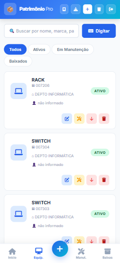
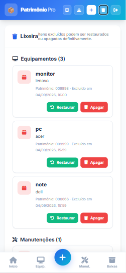

# 📦 Patrimônio Pro — Gestão de Equipamentos e Manutenções

Aplicação web para controle de equipamentos, identificação patrimonial e registro de manutenções, desenvolvida com Python, Flask, SQLAlchemy e SQLite.

O sistema permite consultar equipamentos pela leitura do código de barras da etiqueta de patrimônio, atualizar seus dados, registrar manutenções, realizar baixas e exportar a relação de equipamentos.

## Contexto e objetivo

Desenvolvi este sistema para ajudar no controle dos equipamentos da empresa em que trabalho.

Cada equipamento possui uma etiqueta com identificação patrimonial. A leitura do código de barras pelo celular facilita o cadastro e a consulta das informações, reduzindo a necessidade de procurar os registros manualmente.

A aplicação reúne dados dos equipamentos, manutenções, baixas e histórico de atividades em um único ambiente.

## Situação do projeto

**Em uso e em evolução.**

O sistema é utilizado no controle dos equipamentos e recebe melhorias conforme as necessidades identificadas no dia a dia.

## Principais funcionalidades

- Cadastro e autenticação de usuários.
- Cadastro de equipamentos com identificação patrimonial.
- Leitura de código de barras pela câmera.
- Entrada manual do código.
- Consulta das informações de equipamentos já cadastrados.
- Edição dos dados dos equipamentos.
- Busca e filtros por situação.
- Registro de manutenções.
- Informação de técnico responsável, serviços realizados e custo.
- Registro de próxima manutenção preventiva.
- Baixa de equipamentos.
- Exclusão de registros com envio para a lixeira.
- Restauração de registros excluídos.
- Exclusão definitiva pela lixeira.
- Exportação da relação de equipamentos em CSV.
- Dashboard com indicadores.
- Histórico de atividades recentes.
- Interface responsiva para utilização pelo celular.

## 📸 Demonstração do sistema

As capturas são exibidas sem ampliação. Clique em uma imagem para abrir o arquivo original.

### Visão geral

Dashboard com total de equipamentos, quantidade de ativos, equipamentos em manutenção, baixas e atividades recentes.

<a href="tela%20inicial%282%29.png">
  
</a>

### Consulta de equipamentos

Listagem com identificação patrimonial, localização, situação e acesso às ações de edição, manutenção, baixa e exclusão.

<a href="equipamentos.png">
  
</a>

### Leitura de código de barras

Interface para identificar o equipamento pelo código de barras da etiqueta patrimonial, com alternativa de digitação manual.

<a href="scanear%20c%C3%B3digo%20de%20barras%281%29.png">
  
</a>

### Registro de manutenção

Formulário para registrar equipamento, tipo e data da manutenção, técnico responsável, descrição dos serviços, custo e próxima manutenção preventiva.

<a href="registro%20de%20manuten%C3%A7%C3%A3o.png">
  
</a>

### Acompanhamento das manutenções

Consulta dos registros de manutenção, com busca por equipamento ou técnico e informações sobre o serviço realizado.

<a href="equipamentos%20em%20manuten%C3%A7%C3%A3o.png">
  
</a>

### Equipamentos baixados

Tela dedicada à consulta de equipamentos que receberam baixa.

<a href="equipamentos%20baixados.png">
  
</a>

### Lixeira e recuperação de registros

Área para consultar registros excluídos, restaurar itens removidos por engano ou realizar sua exclusão definitiva.

<a href="lixeira.png">
  
</a>

## Identificação por código de barras

O sistema utiliza o código de barras da etiqueta patrimonial para identificar o equipamento.

| Situação | Funcionamento |
|---|---|
| Equipamento ainda não cadastrado | A leitura auxilia no preenchimento da identificação patrimonial para cadastro. |
| Equipamento já cadastrado | O sistema permite consultar as informações associadas à etiqueta. |
| Fluxo de baixa | A identificação de um equipamento existente permite acessar a opção de baixa. |
| Leitura indisponível | O código pode ser informado manualmente. |

A leitura identifica o registro do equipamento. As informações apresentadas correspondem aos dados cadastrados no sistema.

## Fluxo de utilização

1. Entrar no sistema.
2. Abrir o scanner e apontar a câmera para a etiqueta patrimonial.
3. Cadastrar o equipamento, caso ainda não exista.
4. Consultar as informações dos equipamentos já registrados.
5. Atualizar os dados quando necessário.
6. Registrar manutenções e serviços realizados.
7. Realizar a baixa quando o equipamento deixar de integrar o estoque ativo.
8. Consultar indicadores e exportar a relação de equipamentos.
9. Utilizar a lixeira para recuperar registros excluídos por engano.

## Registro de manutenções

Cada manutenção pode reunir:

- Equipamento relacionado.
- Tipo de manutenção.
- Data da manutenção.
- Técnico responsável.
- Descrição dos serviços realizados.
- Custo.
- Data da próxima manutenção preventiva.

Esses registros ajudam a acompanhar os serviços executados e a manter as informações vinculadas ao equipamento.

## Baixa, exclusão e lixeira

O sistema diferencia a baixa patrimonial da exclusão de um registro.

| Operação | Finalidade |
|---|---|
| Baixa | Identificar que o equipamento deixou de integrar o estoque ativo, mantendo seu registro para consulta. |
| Exclusão | Remover o registro da listagem principal e encaminhá-lo para a lixeira. |
| Restauração | Recuperar um registro excluído por engano. |
| Exclusão definitiva | Apagar permanentemente um registro pela lixeira. |

A lixeira também apresenta registros de manutenção excluídos, com opções de recuperação.

## Exportação de equipamentos

A relação de equipamentos pode ser exportada em formato CSV, compatível com ferramentas de planilhas como Excel e LibreOffice Calc.

A exportação facilita a consulta dos registros fora da aplicação e o apoio a conferências patrimoniais.

## Indicadores e histórico

O dashboard apresenta informações sobre:

- Total de equipamentos cadastrados.
- Equipamentos ativos.
- Equipamentos em manutenção.
- Equipamentos baixados.
- Manutenções realizadas.
- Atividades recentes.

O histórico permite acompanhar as movimentações registradas na aplicação.

## Tecnologias

| Camada | Tecnologias |
|---|---|
| Backend | Python e Flask |
| Persistência | SQLAlchemy e Flask-SQLAlchemy |
| Banco de dados | SQLite |
| Autenticação | Sessões do Flask e hash de senhas com Werkzeug |
| Interface | HTML, CSS e JavaScript |
| Leitura de códigos | Câmera do dispositivo integrada à interface web |
| Exportação | CSV |
| Recursos web | Manifesto e service worker |
| Versionamento | Git e GitHub |

## Organização do código

A aplicação concentra a configuração, os modelos e as rotas no arquivo principal, com separação dos templates e scripts da interface.

```text
app.py
requirements.txt
run.bat
run.sh

templates/
├── auth.html
└── base.html

static/
├── js/
│   └── app.js
├── icons/
├── manifest.webmanifest
└── service-worker.js
```

- **app.py:** configuração, modelos, autenticação e rotas.
- **templates/auth.html:** interface de login e cadastro.
- **templates/base.html:** interface principal do sistema.
- **static/js/app.js:** interações da interface.
- **static/icons:** ícones da aplicação.
- **manifest.webmanifest:** informações para apresentação e instalação da aplicação web.
- **service-worker.js:** recursos do service worker.
- **requirements.txt:** dependências Python.
- **run.bat e run.sh:** scripts auxiliares de inicialização.

## Aspectos técnicos do projeto

- Modelagem de usuários, equipamentos, manutenções e histórico.
- Identificação de equipamentos por código patrimonial.
- Integração da leitura de códigos ao fluxo de consulta e cadastro.
- Persistência dos registros com SQLAlchemy e SQLite.
- Separação entre baixa patrimonial e exclusão de registros.
- Recuperação de itens por meio de lixeira.
- Associação das manutenções aos equipamentos.
- Exportação de dados em CSV.
- Interface voltada ao uso pelo celular.

## Execução local

### 1. Clonar o repositório

```bash
git clone https://github.com/LovanGoulart/patrimonios.git
cd patrimonios
```

### 2. Criar um ambiente virtual

```bash
python -m venv .venv
```

### 3. Ativar o ambiente virtual

**Windows — Git Bash:**

```bash
source .venv/Scripts/activate
```

**Windows — Prompt de Comando:**

```bat
.venv\Scripts\activate.bat
```

**Linux ou macOS:**

```bash
source .venv/bin/activate
```

### 4. Instalar as dependências

```bash
python -m pip install -r requirements.txt
```

### 5. Iniciar a aplicação

```bash
python app.py
```

### 6. Acessar no navegador

```text
http://localhost:5000
```

Na tela de autenticação, utilize a opção de criação de conta para realizar o primeiro acesso.

A aplicação utiliza SQLite e possui inicialização das tabelas no código.

### Acesso à câmera

O navegador precisa de permissão para utilizar a câmera.

Para acessar pelo celular em uma hospedagem, utilize HTTPS. O acesso por HTTP a um endereço IP da rede local pode impedir o funcionamento da câmera.

### Configuração para publicação

Configure uma chave de sessão própria por meio da variável de ambiente:

```text
PATRIMONIO_SECRET_KEY
```

A porta pode ser definida pela variável de ambiente `PORT`. O valor padrão é 5000.

A execução direta de `app.py` utiliza o servidor de desenvolvimento com depuração habilitada. Para produção, utilize configuração própria de hospedagem e mantenha a depuração desativada.

## Autor

Desenvolvido por **Lovan Goulart** para apoiar o controle dos equipamentos da empresa em que trabalha.

[Perfil no GitHub](https://github.com/LovanGoulart)
